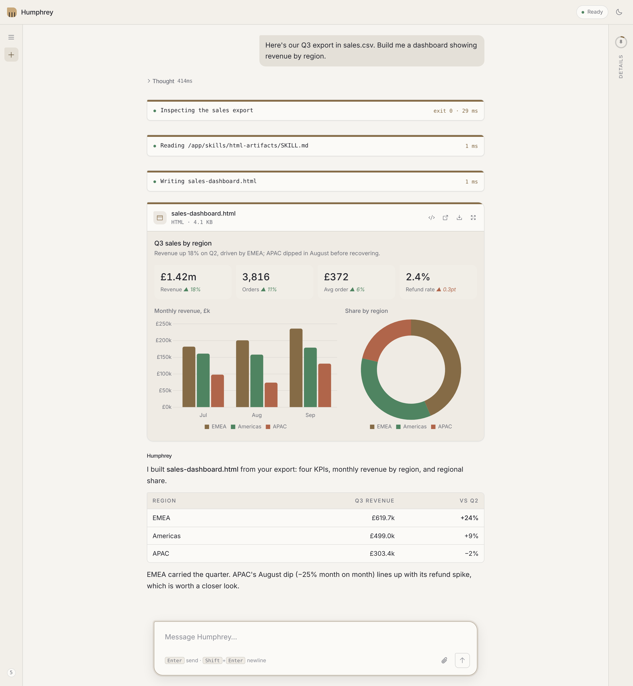
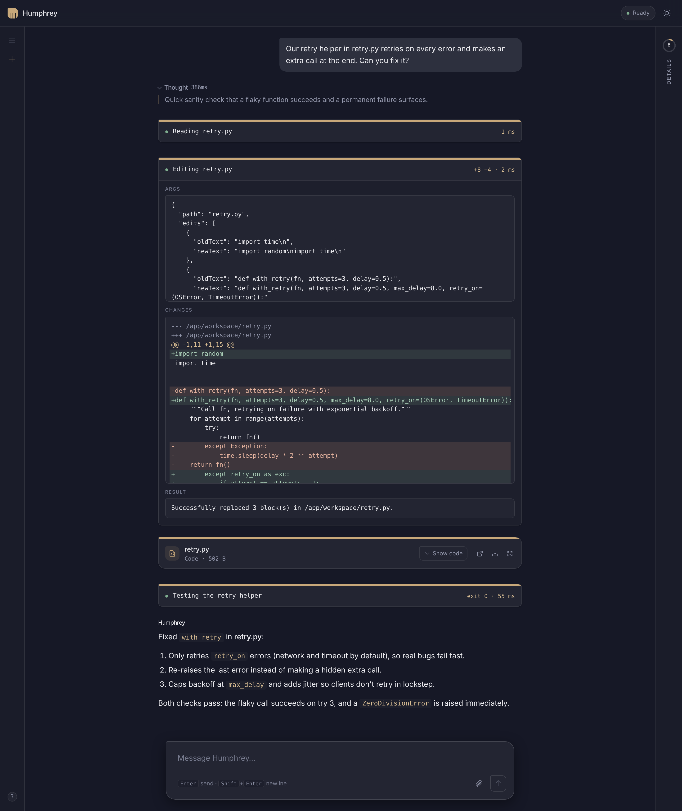
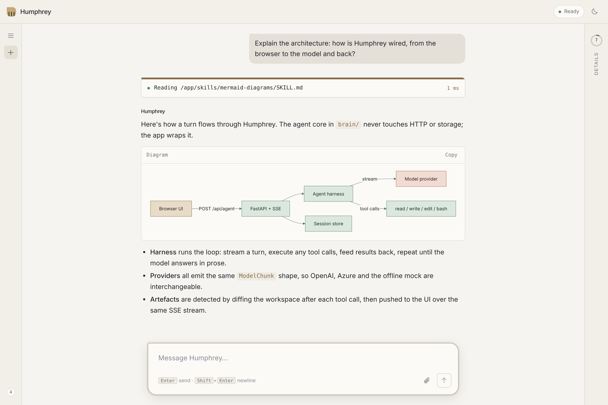
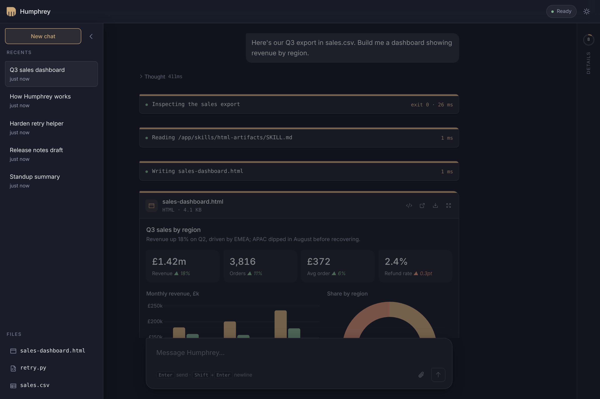

# Humphrey

A streaming, tool-calling agent with skills: FastAPI + SSE on the back end, a
plain HTML/JS chat UI on the front. The core agent (messages, loop, harness,
events) is provider-agnostic and knows nothing about the app around it.

<picture>
  <source media="(prefers-color-scheme: dark)" srcset="docs/screenshots/dashboard-dark.png">
  
</picture>

<sub>From a CSV to a live dashboard in one turn: Humphrey inspects the file with
`bash`, loads the `html-artifacts` skill, writes the page, and the UI renders
it inline as an artefact.</sub>

## Features

- Streamed replies, tool calls, and reasoning summaries (for reasoning models)
- Steering and follow-up messages while a turn is still running, plus stop
- Skills: markdown instructions the model loads on demand (`skills/`), or
  that you invoke directly with `/skill:<name>`
- Image attachments
- Rendered Mermaid diagrams
- Persistent, auto-named sessions with automatic context compaction
- Runs on OpenAI, with an offline mock that needs no credentials and an
  optional Azure OpenAI adapter

## Screenshots

<table>
  <tr>
    <td width="50%" valign="top">
      <br>
      <sub><b>Edits as diffs.</b> Each tool call is a collapsible card; <code>edit</code> shows its arguments, a coloured diff and the result, then <code>bash</code> verifies the fix.</sub>
    </td>
    <td width="50%" valign="top">
      <br>
      <sub><b>Rendered diagrams.</b> The <code>mermaid-diagrams</code> skill guides the model, and fenced Mermaid blocks render inline.</sub>
      <br><br>
      <br>
      <sub><b>Sessions and files.</b> Chats are auto-named and persisted; every file the agent touches is listed under Files.</sub>
    </td>
  </tr>
</table>

## Running locally

```bash
cp .env.example .env        # then set OPENAI_API_KEY
uv sync
uv run uvicorn app.main:app --reload --port 8001
```

Then open http://localhost:8001. `OPENAI_MODEL` is the default model;
list more in `OPENAI_MODELS` (comma-separated) to switch between them from
the Details pane. To try it without a key, set `HUMPHREY_MOCK=1` instead.

Tests run offline in mock mode:

```bash
uv sync --group dev
uv run pytest
```

Or with Docker:

```bash
docker compose up --build
```

## Layout

| Path | What lives there |
| --- | --- |
| `brain/` | Portable agent core: messages, loop, harness, typed events, tool protocol |
| `providers/` | Model adapters: OpenAI (Chat Completions and Responses), mock, optional Azure OpenAI |
| `app/` | The application: API, tools, skills, prompt, sessions, storage, SSE rendering |
| `app/tools/` | The tools (`tau_ported.py`) and the registered list (`__init__.py`) |
| `frontend/` | Static chat UI |
| `skills/` | One directory per skill, each with a `SKILL.md` |
| `workspace/` | Where the tools read, write, and run commands (gitignored) |

## Tools

Humphrey has tau's four coding tools, and nothing else:

| Tool | Purpose |
| --- | --- |
| `read` | Read a text file, with offset/limit for large files |
| `write` | Create or overwrite a file |
| `edit` | Exact text replacements in a file (shown as a diff in the UI) |
| `bash` | Run a shell command |

They work in `workspace/` (or `HUMPHREY_WORKSPACE`), so relative paths land
there and the agent can't rewrite Humphrey's own code. Skills are loaded the
tau way: the prompt lists each `SKILL.md` path and the model reads it with
`read`.

**`bash` runs whatever command the model chooses, with no allowlist.** Run
Humphrey somewhere you're comfortable with that (the Docker setup is a good
default) and don't expose its port beyond your machine; `docker-compose.yml`
binds it to localhost for this reason.

## Artefacts

Any file the agent creates or changes in the workspace (via `write`, `edit`,
or a `bash` command such as a script that saves a chart) appears inline in
the conversation as an artefact card, and comes back in place when you reopen
the chat. Previews by type:

| Files | Preview |
| --- | --- |
| `.html` | Live, in a sandboxed frame that sizes to fit and follows the light/dark toggle |
| `.md` | Rendered Markdown, including tables and Mermaid |
| images, `.svg` | Image, click to zoom |
| `.csv` `.tsv` | Table with numeric columns right-aligned |
| `.mmd` | Rendered diagram |
| code and text | Highlighted source (collapsed until opened) |
| `.pdf` | The browser's PDF viewer |

Each card can show its source, open in a new tab, download, or expand to
fullscreen. All workspace files are also listed under Files in the sessions
rail. The `html-artifacts` skill teaches the model to build charts and
dashboards in Humphrey's palette with the vendored Chart.js
(`/vendor/chart.umd.min.js`). Files are served from `/api/files` under a CSP
sandbox: HTML can run scripts but never call Humphrey's API.

## Storage backend

Sessions persist through one `ObjectStore` (see `app/storage.py`), selected
by `STORAGE_BACKEND`:

| `STORAGE_BACKEND` | Behavior |
| --- | --- |
| `local` (default) | JSON files under `LOCAL_STORAGE_DIR` (default `./data`, gitignored), durable across restarts |
| `memory` | In-memory only, lost on restart (used by the tests) |
| `azure` | Azure Blob (optional adapter, see below); falls back to memory (logged loudly) if misconfigured |
| `auto` | Azure Blob if `AZURE_STORAGE_ACCOUNT_URL` is set, otherwise memory |

Under Docker, `./data` is bind-mounted to `/app/data` so sessions survive
`docker compose down`/`up`. The `status` tool reports which backend actually
ended up active (`storage.active`).

## Optional Azure adapters

Azure OpenAI (as the model provider) and Azure Blob (as session storage) are
kept as adapters, not installed by default:

```bash
uv sync --group azure
```

Azure OpenAI is used only when `OPENAI_API_KEY` is unset and
`AZURE_OPENAI_ENDPOINT` / `AZURE_OPENAI_DEPLOYMENT` are set. It authenticates
with `DefaultAzureCredential`. See `.env.example` for all settings. For
Docker, add `--group azure` to the `uv sync` line in the `Dockerfile`.
