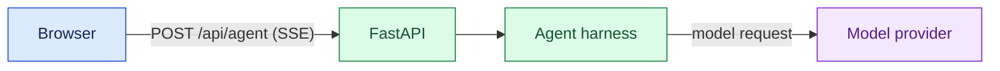

Use this skill when architecture, a request flow, an interaction sequence, or another relationship is easier to understand as a picture than as a list.

Before drawing, work out:

What should the reader understand after looking at the diagram?
Which components or events are necessary to answer that question?
Which relationships, directions, or boundaries matter?
Would a flowchart or sequenceDiagram express those relationships more clearly?

Then draw the smallest diagram that answers the question. Group or omit detail that does not help the reader. If the diagram becomes crowded, split it into focused diagrams and explain the connection in prose. Keep labels short and use familiar names.

Use flowchart for architecture and request flows. Use sequenceDiagram when timing, order, or back-and-forth between participants is the point.

Use colour when it helps readers distinguish meaningful categories, such as client, application, and external service. Give each colour a consistent meaning, use readable contrast, and make the categories clear from labels as well as colour. Avoid colour that is purely decorative.

The frontend renders fenced mermaid blocks, but its parser is strict:

Quote every flowchart node and edge label: A["FastAPI"] and A -->|"POST /api/agent (SSE)"| B.
Never put parentheses in an unquoted label.
Never use end as a node ID.
Keep diagrams compact, with no more than five nodes or participants across a row.
Avoid HTML labels and diagram configuration directives.

Example:

Check the finished diagram against the original question. A reader should be able to follow its main point without decoding every implementation detail.